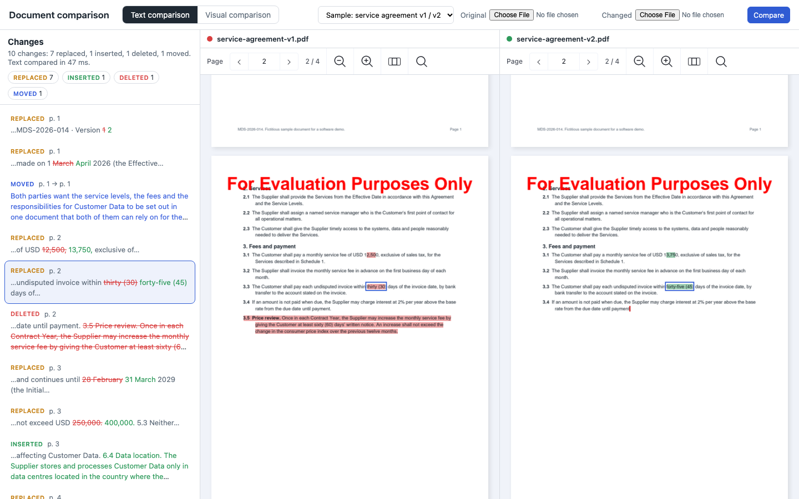
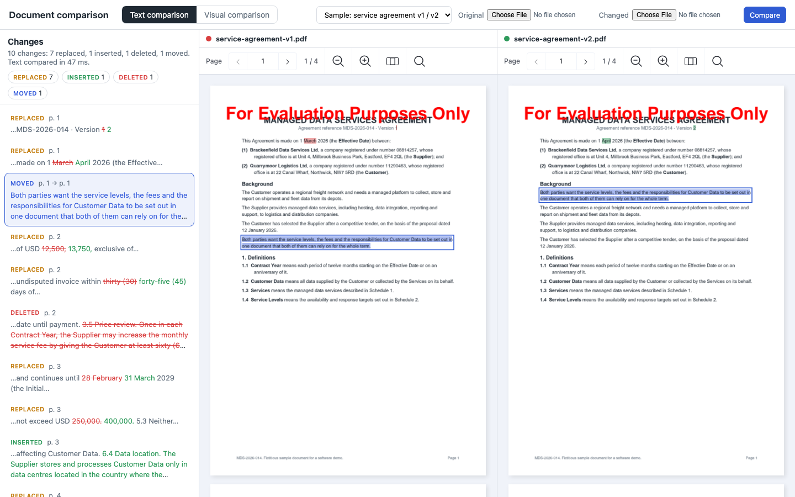
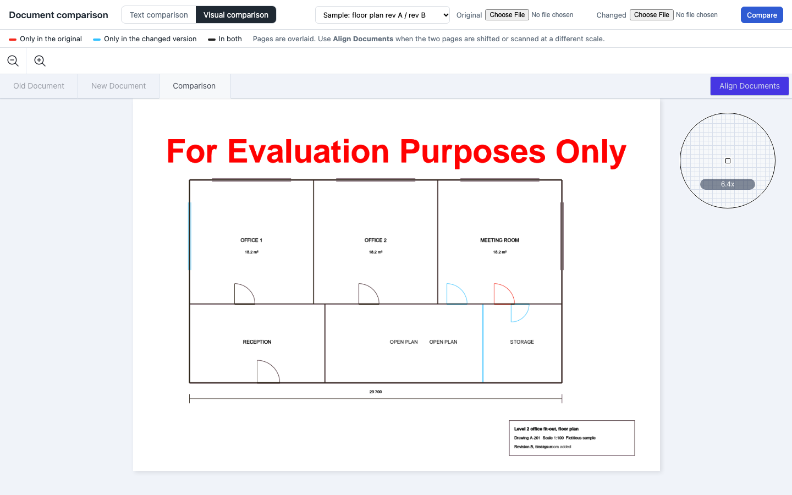

# Nutrient Document Comparison

A Nutrient.io demo that compares two versions of a document in the browser with the Nutrient Web SDK: a text comparison of two contract versions with a clickable list of changes, and a coloured overlay of two revisions of a drawing.



1. **Load.** Both versions open side by side in two Web SDK viewers, in standalone mode. The PDFs never leave the browser.
2. **Compare the text.** `instance.compareDocuments()` with a `ComparisonOperation` of type `TEXT` compares the two documents page by page: page 1 with page 1, page 2 with page 2. The SDK returns hunks of `equal`, `delete` and `insert` operations, with the rectangles of the text in each document.
3. **List the changes.** `public/changes.js` turns the operations into changes: replaced (a deletion followed by an insertion), inserted and deleted. The SDK diff can cut a word, for example `2,50` to `3,75` inside `12,500` to `13,750`. The app completes the words with the context words the SDK returns (`numberOfContextWords: 3`) and shows each change inline, in its sentence. A deleted passage of at least 25 characters that comes back elsewhere with the same words (90% word overlap) is reported as moved.
4. **Highlight.** Highlight annotations mark every change: red in the original, green in the changed version, blue for moved text. A thin caret marks where text was removed, or will be inserted, on the other side.
5. **Navigate.** Clicking a change frames it in both documents (`jumpToRect`). Clicking a highlight in a document selects its change in the list. Filters hide a type of change.
6. **Compare visually.** For drawings and scanned pages, `instance.setDocumentComparisonMode()` overlays two pages. Strokes only in the original are red, strokes only in the changed version are blue, strokes in both are black. **Align Documents** aligns two pages that are shifted or scanned at another scale, with three points picked on each page.

Everything runs in the browser. The Node server only serves the files.

## Prerequisites

- Node.js 22.9 or later. The server has no dependencies.
- A recent desktop browser: Chrome, Edge, Firefox or Safari. Windows, macOS or Linux.
- Internet access: the page loads Web SDK 1.24.0 from the Nutrient CDN.
- Optional: Python 3.10 or later with reportlab, to regenerate the samples.
- Optional: Playwright's Chromium, for the detection check (`npm run verify`).

## Environment variables

Start from `.env.example`. `npm start` reads `.env` if it exists. The license key is never written in the code: the server passes it to the page through `/config.js`.

| Variable | Purpose | Default |
|---|---|---|
| `NUTRIENT_LICENSE_KEY` | Nutrient Web SDK license key | empty = evaluation mode |
| `PORT` | Port of the static server | `4510` |
| `HOST` | Address the server listens on | `127.0.0.1` |
| `VERIFY_PORT` | Port of the server started by `npm run verify` | `4519` |

Text comparison and document comparison are separate components of a Web SDK license. In evaluation mode both work and the pages show a watermark.

## Build and run

```bash
cp .env.example .env
```

```bash
npm start
```

Open <http://localhost:4510>.

## Using the app

1. **Text comparison** opens with the sample service agreement, version 1 on the left and version 2 on the right. The panel lists 10 changes with their type, page and sentence: deleted text in red and struck through, inserted text in green.
2. Click a change: both documents scroll to it and frame it in blue. Click a highlight in a document to find its change in the list. The chips at the top hide or show a type of change.
3. A moved paragraph is listed once, with its page in each version, and highlighted in blue on both sides.

   

4. **Visual comparison** opens the sample floor plan, revision A over revision B. Use the **Old Document** and **New Document** tabs to see each revision alone.

   

5. **Your files:** choose two PDFs next to **Original** and **Changed**, then click **Compare**. In the visual comparison, page 1 of each file is compared.

URL parameters open a sample directly: `?sample=contract` or `?sample=plan`.

## What the comparison finds in the samples

The text comparison of `service-agreement-v1.pdf` and `service-agreement-v2.pdf` finds every edit made by the sample generator:

| Edit | Page | Found as |
|---|---|---|
| Effective date, 1 March 2026 to 1 April 2026 | 1 | Replaced: `March` to `April` |
| Background paragraph moved from the end to the start of the section | 1 | Moved |
| Monthly fee, USD 12,500 to USD 13,750 | 2 | Replaced: `12,500` to `13,750` |
| Payment term, 30 to 45 days | 2 | Replaced: `thirty (30)` to `forty-five (45)` |
| Clause 3.5, price review, deleted | 2 | Deleted |
| End of the initial term, 28 February 2029 to 31 March 2029 | 3 | Replaced: `28 February` to `31 March` |
| Liability cap, USD 250,000 to USD 400,000 | 3 | Replaced: `250,000` to `400,000` |
| New clause 6.4, data location | 3 | Inserted |
| Reasonable endeavours to best endeavours | 4 | Replaced: `reasonable` to `best` |

The tenth change is the version label on page 1, `Version 1` to `Version 2`, which is a real difference between the files. The comparison takes about 50 ms for the four pages.

The visual comparison of the floor plan revisions shows the changed strokes in colour: the meeting room door at its old place (red) and its new place (blue), the new partition wall, the storage room door and the new window in the west wall (blue). Text keeps its own colour: the moved "OPEN PLAN" label, the new "STORAGE" label and the new revision line of the title block appear in black, overlaid. For these, run the text comparison on the same two files: it lists `STORAGE` as inserted and the revision line as replaced. A label that only moved is not a text change.

## Detection check

`tools/verify-detection.mjs` starts the server, opens the app in headless Chromium, runs the text comparison of the sample contract and matches the changes against `public/samples/expected-changes.json`.

```bash
npm install
```

```bash
npx playwright install chromium
```

```bash
npm run verify
```

```text
found    payment-term         replacement  replaced c5: "thirty (30)" -> "forty-five (45)"
found    deleted-clause       deletion     deleted c6: "3.5 Price review. Once in each Contract " -> ""
...
9 of 9 edits found.
1 other change(s), not in the list of edits:
  replaced p. 1: "1" -> "2"
```

`npm run verify -- --screenshots docs/screenshots` also writes the screenshots of this README.

## Samples

`tools/generate_samples.py` creates the samples with reportlab: the fictitious service agreement in two versions, the floor plan in two revisions and `expected-changes.json`, the list of edits. Both contract versions keep the same page breaks. Every party, person, address and figure is invented.

```bash
python3 -m venv .venv
```

```bash
.venv/bin/pip install -r tools/requirements.txt
```

```bash
.venv/bin/python tools/generate_samples.py
```

## Project layout

| Path | Content |
|---|---|
| `server.mjs` | Static server and `/config.js` |
| `public/index.html`, `public/style.css` | Page layout |
| `public/app.js` | Viewers, text comparison, highlights, navigation, visual comparison |
| `public/changes.js` | Turns the SDK result into replaced, inserted, deleted and moved changes |
| `public/samples/` | Sample documents and the list of edits |
| `tools/generate_samples.py` | Sample generator |
| `tools/verify-detection.mjs` | Detection check and screenshots |

## Limitations

- The SDK compares page 1 with page 1, page 2 with page 2. Text pushed onto the next page by an insertion is deleted at the bottom of one page and inserted at the top of the next: the app lists it as moved across the page break.
- Moves are detected by the app, not by the SDK: a deleted passage and an inserted passage with the same words. Short moved phrases (under 25 characters) are listed as a deletion and an insertion.
- The visual comparison colours strokes, not text. It compares one page of each document.
- Scanned pages have no text layer, so the text comparison finds nothing on them. Use the visual comparison, or run OCR on the scans first.
- The highlights are only shown in the viewers. The documents are not changed and no report is exported.
